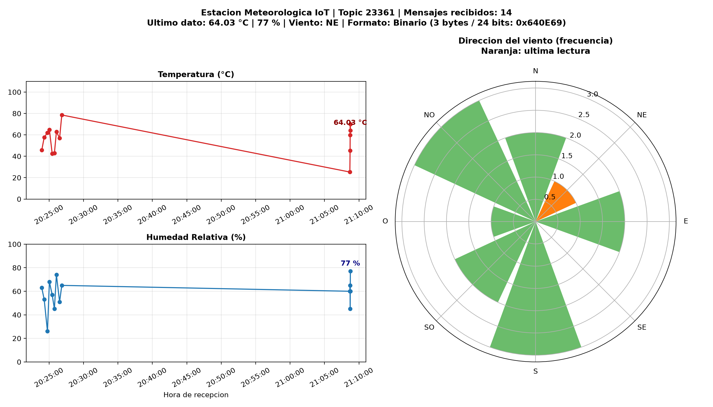
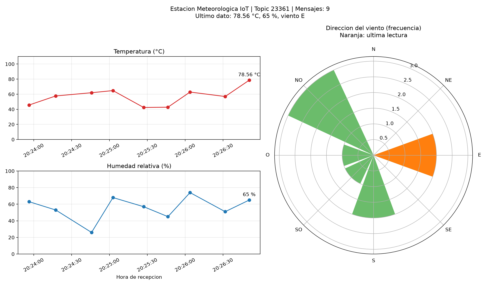

# Estación Meteorológica IoT con Apache Kafka

**Universidad del Valle de Guatemala**  
**CC3067 - Redes**  
- **Roberto Barreda**, 23354  
- **Javier España**, 23361  

Topic asignado: `23361`  
Broker Edge: `161.35.11.141:9092` (SASL_PLAINTEXT / PLAIN)  

---

## 1. Descripción del Proyecto

El sistema implementa y simula una estación meteorológica IoT completa con arquitectura Edge Computing basada en el patrón Publicador/Suscriptor (Pub/Sub) utilizando Apache Kafka:

1. **Nodo Sensor (Producer - `producer.py`):** Simula un nodo físico en el borde con tres sensores:
   - **Termómetro:** Rango $[0, 110.00] \text{ }^\circ\text{C}$, float con dos decimales, distribución normal centrada en 55 ($\mu=55, \sigma=15$).
   - **Higrómetro:** Rango $[0, 100] \%$, entero, distribución normal centrada en 55 ($\mu=55, \sigma=15$).
   - **Anemómetro (Dirección del viento):** Distribución uniforme sobre $\{N, NE, E, SE, S, SO, O, NO\}$.
   - Publica periódicamente (cada 15 a 30 segundos) con la llave `sensor1`.

2. **Receptor y Visualizador (Consumer - `consumer.py`):** Se suscribe al topic `23361` desde el inicio (`auto.offset.reset=earliest`) y grafica en tiempo real:
   - Serie temporal de Temperatura ($^\circ\text{C}$).
   - Serie temporal de Humedad Relativa ($\%$).
   - Rosa de los vientos (gráfico polar con frecuencias por dirección, resaltando la última en naranja).
   - Detección automática del formato recibido (Binario compacto o JSON).

---

## 2. Restricción IoT: Carga Útil de 3 Bytes / 24 Bits (Sección 3.4)

En redes de área amplia y bajo consumo (LPWAN como LoRaWAN y Sigfox), el tamaño del payload es un recurso extremadamente crítico. Para cumplir con la restricción de **máximo 3 bytes (24 bits)** por mensaje, se diseñó el módulo [`codec.py`](codec.py) con funciones `encode_payload` / `json_to_bytes` y `decode_payload` / `bytes_to_json`.

### Distribución de los 24 bits:

```text
+--------------------------------+-----------------------+---------------------+
|      Temperatura (14 bits)     |   Humedad (7 bits)    |  Viento (3 bits)    |
|       Bits 23 a 10             |     Bits 9 a 3        |     Bits 2 a 0      |
+--------------------------------+-----------------------+---------------------+
| Rango: 0 a 11000 (temp * 100)  | Rango: 0 a 100        | 8 direcciones (0-7) |
| Max 14 bits: 16383 >= 11000    | Max 7 bits: 127 >= 100| Max 3 bits: 7 >= 7  |
+--------------------------------+-----------------------+---------------------+
Total = 14 + 7 + 3 = 24 bits (exactamente 3 bytes)
```

- **Ejemplo JSON:** `{"temperatura": 56.32, "humedad": 51, "direccion_viento": "SO"}` (~63 bytes).
- **Ejemplo 3 Bytes:** `0x580E6D` (3 bytes, **reducción de más del 95%** en el uso de ancho de banda).

---

## 3. Instalación y Requisitos

Se requiere Python 3.9 o superior.

```bash
pip install -r requirements.txt
```

O utilizando `uv`:

```bash
uv venv .venv
.\.venv\Scripts\activate
uv pip install -r requirements.txt
```

---

## 4. Guía de Ejecución

### Modo 1: Restricción IoT - 3 Bytes / 24 Bits (Por defecto)

**Terminal 1 (Productor en modo binario compacto):**
```bash
python producer.py --mode binary
```

**Terminal 2 (Consumidor en tiempo real):**
```bash
python consumer.py --save capturas/grafica_consumidor_3bytes.png
```

### Modo 2: Modo JSON estándar

**Terminal 1:**
```bash
python producer.py --mode json
```

**Terminal 2:**
```bash
python consumer.py
```

### Opciones de línea de comandos:
- `python producer.py --min 2 --max 4 --count 10`: Envío acelerado para pruebas (10 mensajes).
- `python consumer.py --group nuevo-grupo`: Cambia el `group.id` para re-leer todo el histórico de mensajes del broker.
- `python consumer.py --headless --exit-on-idle 5 --save capturas/grafica.png`: Ejecuta sin ventana gráfica y guarda la gráfica en PNG.

---

## 5. Pruebas Unitarias

Para verificar la fidelidad de la codificación y decodificación de los 3 bytes en todos los límites:

```bash
python test_codec.py
```

---

## 6. Evidencia y Capturas de Pantalla

### Gráfica del Consumidor en Tiempo Real (Consumiendo Mensajes Binarios de 3 Bytes)


### Gráfica del Consumidor (Fase Inicial JSON)


---

## 7. Preguntas Teóricas del Laboratorio

Las respuestas completas, detalladas y fundamentadas técnica y matemáticamente a todas las preguntas de la guía (Secciones 3.1, 3.3 y 3.4) se encuentran documentadas en:
👉 [**`RESPUESTAS.md`**](RESPUESTAS.md)
